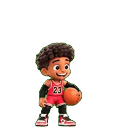

# K2 — a floating desktop companion for Claude Code

A small, borderless, always-on-top pet that sits next to a Claude Code session
and reacts to what's happening in it (idle, running, waiting for permission,
working, etc.). Runs entirely locally — a Node server plus a Python-driven
native window, no cloud dependency, no data leaves your machine.

**To install and run it: see [`AGENTS.md`](AGENTS.md).** That file is written
as an explicit, tested contract for a coding agent (or a human) to follow —
start there, not here. It covers macOS and Windows.

## What's in this folder

- `public/companion.html` + `public/companion.js` — the pet's UI
- `assets/` — character sprite sheets (Gentleman KK, K2 Nkama, Einstein,
  Bruce Lee, BBALL)
- `claude-code-integration/` — the floating-window script and the autostart
  hook that runs it when a Claude Code session begins
- `character-generation/` — the real, separate pipeline for building a new
  character from a reference sheet (see `character-generation/PROMPT_TEMPLATE.md`)
  — a manual, creative process, not part of installing the app itself
- `scripts/` — the install contract's actual scripts (see `AGENTS.md`)

## Internal dev tooling (not the product)

`src/server.mjs` also has an `--record` flag and a `src/app-server-recorder.mjs`
companion used during development to capture and replay real session traces —
these are debugging aids for working on the state-mapping logic itself, not
something installing or running the pet needs. If you're just here to get the
companion running, ignore this section entirely and follow `AGENTS.md`.
